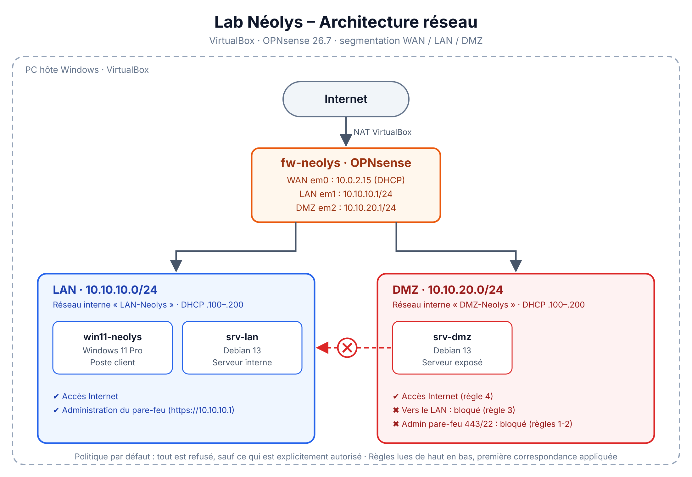

# Lab Néolys – Laboratoire d'entreprise virtualisé

Projet 1 de mon parcours autodidacte **Administrateur systèmes, réseaux et cybersécurité**.

Néolys est une PME fictive de 45 salariés. J'ai construit son infrastructure de test : un pare-feu qui sépare le réseau interne (LAN) d'une zone exposée (DMZ), avec des postes Windows et des serveurs Linux.

## Documentation

- [Procédure d'installation pas à pas](docs/procedure-installation.md)
- [Journal de dépannage (11 incidents résolus)](docs/journal-depannage.md)

## Objectifs

- Comprendre et utiliser la virtualisation (hyperviseur de type 2, réseaux virtuels)
- Installer et configurer un pare-feu OPNsense
- Segmenter un réseau : WAN / LAN / DMZ
- Écrire des règles de filtrage (refus par défaut, première règle qui correspond)
- Préparer un modèle Debian et le cloner proprement
- Tester, dépanner et documenter une infrastructure

## Architecture



| Zone | Réseau | Passerelle | DHCP | Réseau VirtualBox |
|---|---|---|---|---|
| WAN | 10.0.2.0/24 | 10.0.2.2 | via NAT | NAT |
| LAN | 10.10.10.0/24 | 10.10.10.1 | .100 à .200 | LAN-Neolys |
| DMZ | 10.10.20.0/24 | 10.10.20.1 | .100 à .200 | DMZ-Neolys |

## Machines virtuelles

| VM | Système | Rôle | Réseau | RAM |
|---|---|---|---|---|
| fw-neolys | OPNsense 26.7 | Pare-feu / routeur / DHCP / DNS | WAN + LAN + DMZ | 2 Go |
| win11-neoly | Windows 11 Pro | Poste client | LAN | 4 Go |
| debian-template | Debian 13 | Modèle de serveur (ne tourne pas) | – | 2 Go |
| srv-lan | Debian 13 | Serveur interne | LAN | 2 Go |
| srv-dmz | Debian 13 | Serveur exposé | DMZ | 2 Go |

## Règles du pare-feu (interface DMZ)

| # | Action | Source | Destination | Port | But |
|---|---|---|---|---|---|
| 1 | Bloquer | DMZ net | DMZ address | 443 | Pas d'accès à l'admin web du pare-feu |
| 2 | Bloquer | DMZ net | DMZ address | 22 | Pas d'accès SSH au pare-feu |
| 3 | Bloquer | DMZ net | LAN net | tous | Un serveur DMZ compromis ne peut pas atteindre le LAN |
| 4 | Autoriser | DMZ net | any | tous | Accès Internet (mises à jour) |

Principe : un serveur en DMZ est considéré comme potentiellement compromis. Il ne doit jamais pouvoir joindre le réseau interne.

## Tests de validation

| Test | Depuis | Résultat attendu | Résultat obtenu |
|---|---|---|---|
| Adresse DHCP | win11 | 10.10.10.x, passerelle 10.10.10.1 | ✅ 10.10.10.156 |
| `ping 10.10.10.1` | srv-lan | Répond | ✅ 0 % de perte |
| `ping 9.9.9.9` | srv-lan | Répond | ✅ 0 % de perte |
| `ping 10.10.20.1` | srv-dmz | Répond | ✅ 0 % de perte |
| `ping 9.9.9.9` | srv-dmz | Répond (Internet autorisé) | ✅ 0 % de perte |
| `ping 10.10.10.1` | srv-dmz | Bloqué (LAN interdit) | ✅ 100 % de perte |
| `ping 10.10.10.96` (srv-lan) | srv-dmz | Bloqué (LAN interdit) | ✅ 100 % de perte |
| `curl -k -m 5 https://10.10.20.1` | srv-dmz | Bloqué (admin interdite) | ✅ timeout |

Captures dans [`captures/`](captures/).

## Problèmes rencontrés et solutions

| Problème | Cause | Solution |
|---|---|---|
| « CPU doesn't support long mode » | VM déclarée en 32 bits | Type FreeBSD (64-bit) |
| Kernel panic « atpic requires a local APIC » | I/O APIC désactivé | Activer l'I/O APIC dans Système › Carte mère |
| Configuration OPNsense perdue au redémarrage | La VM démarrait sur l'ISO (mode live) | Retirer l'ISO, disque dur en 1er dans l'ordre d'amorçage |
| Mot de passe root refusé en console | Clavier en QWERTY à la console | Mot de passe sans lettres A/Q/Z/W/M |
| Windows en 169.254.x.x | Pare-feu éteint, aucun DHCP | Démarrer fw-neolys, `ipconfig /renew` |
| Clones Debian identiques | machine-id et clés SSH copiés | Vider `/etc/machine-id`, supprimer les clés hôtes, les régénérer sur chaque clone |
| Bureau GNOME installé par erreur | Case « Environnement de bureau » restée cochée | `systemctl set-default multi-user.target` (démarrage en mode console) |
| `openssh-server` absent | Case « serveur SSH » non cochée | `apt install openssh-server` sur chaque clone |
| `ifup` : « unknown interface » | Réseau géré par NetworkManager (installé avec GNOME) | Utiliser `nmcli` |
| srv-dmz sans adresse IPv4 | DHCP non actif sur l'interface DMZ | Diagnostic avec une IP fixe (`ip addr add`), puis activation du DHCP DMZ dans OPNsense |
| srv-lan reçoit 10.10.10.96 au lieu de .100-.200 | Plage DHCP saisie en console non appliquée | Correction de la plage dans Services › DHCP |

## Préparation du modèle Debian

```bash
# Sur le modèle, avant clonage
sudo truncate -s 0 /etc/machine-id
sudo rm -f /etc/ssh/ssh_host_*
sudo apt clean
sudo poweroff

# Sur chaque clone
sudo hostnamectl set-hostname srv-lan
sudo sed -i 's/debian-template/srv-lan/g' /etc/hosts
sudo systemd-machine-id-setup
sudo apt install -y openssh-server   # génère des clés SSH propres au clone
sudo reboot
```

## Méthode de dépannage utilisée

1. Lire le message d'erreur exact (console, `ip a`, `nmcli`)
2. Tester couche par couche : adresse IP → passerelle → Internet → DNS
3. Isoler la cause avec un test simple (IP fixe pour séparer « problème de câble » et « problème de DHCP »)
4. Corriger, retester, documenter

## Compétences mises en œuvre

Virtualisation (VirtualBox) · Pare-feu OPNsense · Segmentation réseau LAN/DMZ · Filtrage stateful · DHCP / DNS · Administration Debian · Windows 11 · Dépannage réseau · Documentation technique

## Prochaine étape

Projet 2 : support utilisateurs avec ITIL et GLPI, sur ce même lab.

## Structure du dépôt

```
lab-neolys/
├── README.md
├── schema/
│   └── schema-reseau.png
├── docs/
│   ├── procedure-installation.md
│   └── journal-depannage.md
├── captures/
│   ├── 01-opnsense-console.png
│   ├── 02-regles-dmz.png
│   ├── 03-win11-ipconfig.png
│   ├── 04-srv-lan-tests.png
│   └── 05-srv-dmz-tests-filtrage.png
└── config/
    └── opnsense-config.xml   (export SANS mots de passe)
```
